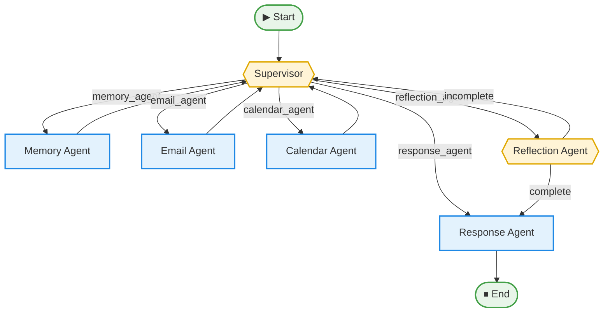

# A.L.D.R (Adler)

A multi-agent personal assistant built with [LangGraph](https://github.com/langchain-ai/langgraph). A central **Supervisor** agent reads your request and routes it to specialist agents for memory retrieval, email, and calendar tasks. A **Reflection** agent checks whether the work is actually done before a final **Response** agent replies.

You talk to it from the command line as the "Commander".

## Features

- **Supervisor-based routing**: an LLM decides which agent should act next, using structured output.
- **Memory agent**: retrieves relevant emails and context to ground answers.
- **Email agent**: handles email tasks such as sending messages.
- **Calendar agent**: creates and manages calendar events.
- **Reflection loop**: verifies the task is complete, and sends control back to the Supervisor if it isn't.
- **Human-in-the-loop**: if an agent needs more information (a recipient, a time, etc.), the workflow pauses with `WAITING_FOR_USER`, asks you, and resumes the same agent with your reply.
- **Conversation persistence**: in-session state is kept with LangGraph's `MemorySaver` checkpointer.

## Architecture



The Memory, Email, and Calendar agents always return to the Supervisor. The Supervisor routes to Reflection when it thinks the task is done, and Reflection either approves (going to the Response agent) or sends the task back for more work.

## Project structure

```
adler/
├── adler.py          # Graph definition and CLI entry point
├── state.py          # Shared AgentState, Pydantic result schemas, LLM setup
├── Nodes/            # Agent nodes (supervisor, memory, email, calendar, reflection, response)
├── Helpers/          # Conditional edge routers (supervisor_router, reflection_router)
├── database/         # Data/storage layer
├── mailhandler/      # Email integration
├── heartbeat.txt
└── .gitignore
```

## Tech stack

- Python 3
- [LangGraph](https://github.com/langchain-ai/langgraph) and LangChain Core
- [Groq](https://groq.com/) via `langchain-groq` (model: `openai/gpt-oss-120b`, temperature 0)
- Pydantic for structured agent outputs
- `python-dotenv` for configuration

## Getting started

### Prerequisites

- Python 3.10+
- A [Groq API key](https://console.groq.com/)
- Credentials for the email and calendar services you connect (see `mailhandler/`)

### Installation

```bash
git clone https://github.com/imadzaanine/adler.git
cd adler

python -m venv venv
source venv/bin/activate        # Windows: venv\Scripts\activate

pip install langgraph langchain-core langchain-groq pydantic python-dotenv
```

> There is no `requirements.txt` yet. Add any extra packages used by `database/` and `mailhandler/` to the install command above.

### Configuration

Create a `.env` file in the project root:

```env
GROQ_API_KEY=your_groq_api_key
ADLER_USER_ID=your_user_id
```

`ADLER_USER_ID` is required: the app reads it at startup and passes it to the agents as the current user. Add any further variables your email, calendar, or database setup needs.

### Run

```bash
python adler.py
```

## Usage

```
Commander: Schedule a meeting with Sarah tomorrow at 3pm
A.L.D.R: Sure, what should the meeting be called?

Commander: Project sync
A.L.D.R: Done. "Project sync" is booked for tomorrow at 3:00 PM.
```

Type `exit` or `quit` to leave. Press `Ctrl+C` during a request to cancel it.

## How it works

1. `adler.py` compiles the LangGraph state graph with a `MemorySaver` checkpointer.
2. Your message becomes the first turn (or a continuation of the existing thread).
3. The Supervisor emits a `SupervisorDecision` (`MEMORY`, `EMAIL`, `CALENDAR`, `REFLECTION`, or `FINAL`) and the router sends the state to the matching node.
4. Each agent returns a typed result (`COMPLETED`, `WAITING_FOR_USER`, or `FAILED`) stored in the shared `AgentState`.
5. If an agent is waiting on you, your next message resumes that same agent.
6. Reflection marks the work `COMPLETE` or `INCOMPLETE`, and the Response agent writes the final reply.